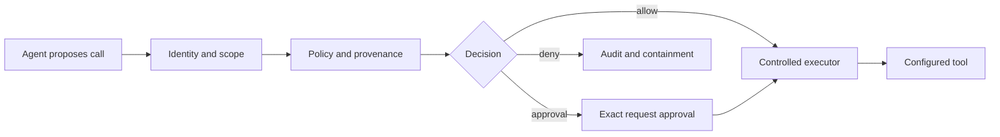

# SentinelGate architecture overview

## Decision path

The agent proposes an action but does not grant itself authority to execute it. The gateway binds the authenticated principal, exact arguments, provenance, policy version and current tool definition into the decision. Approval is an exact, expiring, one-time capability—not a general permission.

## Durable components

- PostgreSQL or SQLite stores identity state, decisions, approvals, traces and the outbox.
- An HMAC-linked audit chain makes local record modification detectable when the signing key remains protected.
- A separate worker claims notification jobs with leases, retries and dead-letter handling.
- Prometheus output exposes bounded operational metrics without tool arguments.

## Deployment separation

The public marketing process contains no control-plane routes or credentials. The private gateway hosts the API and console. Production deployments should put both behind HTTPS and restrict the gateway to authorised operators and integrations.

See `src/sentinelgate/static/sentinelgate-threat-model.md` for the full boundary and residual risks.
